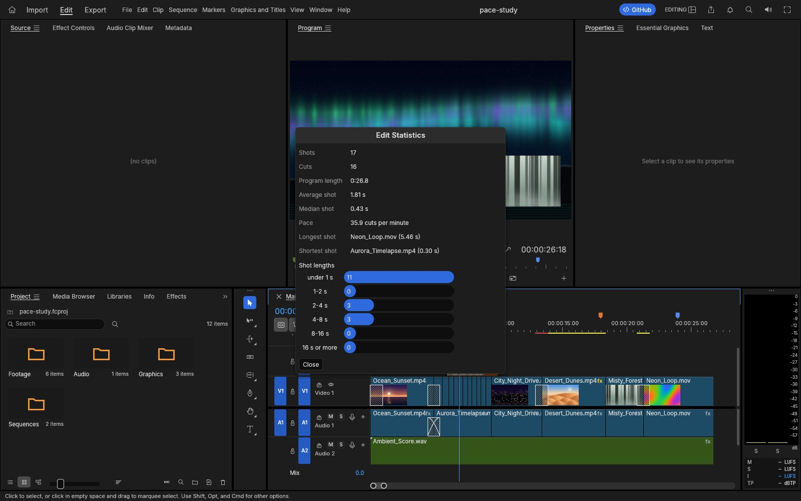
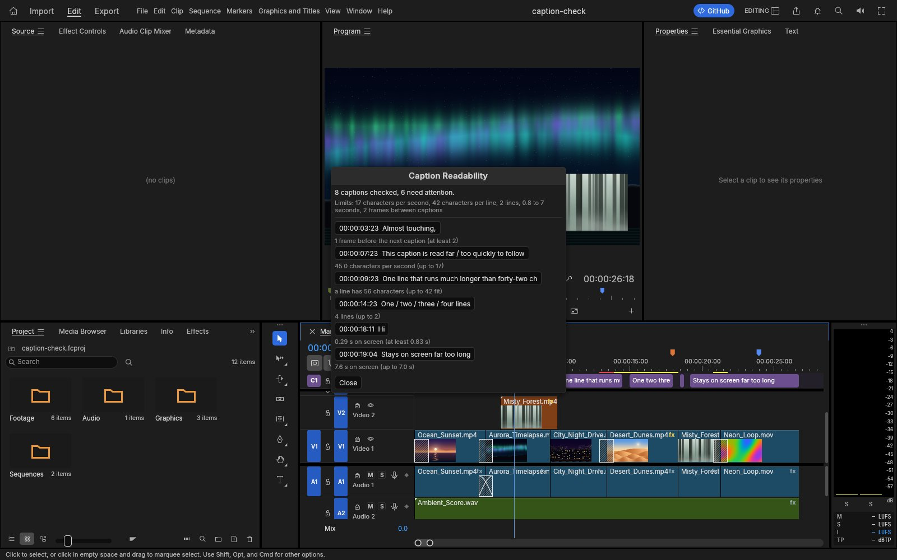
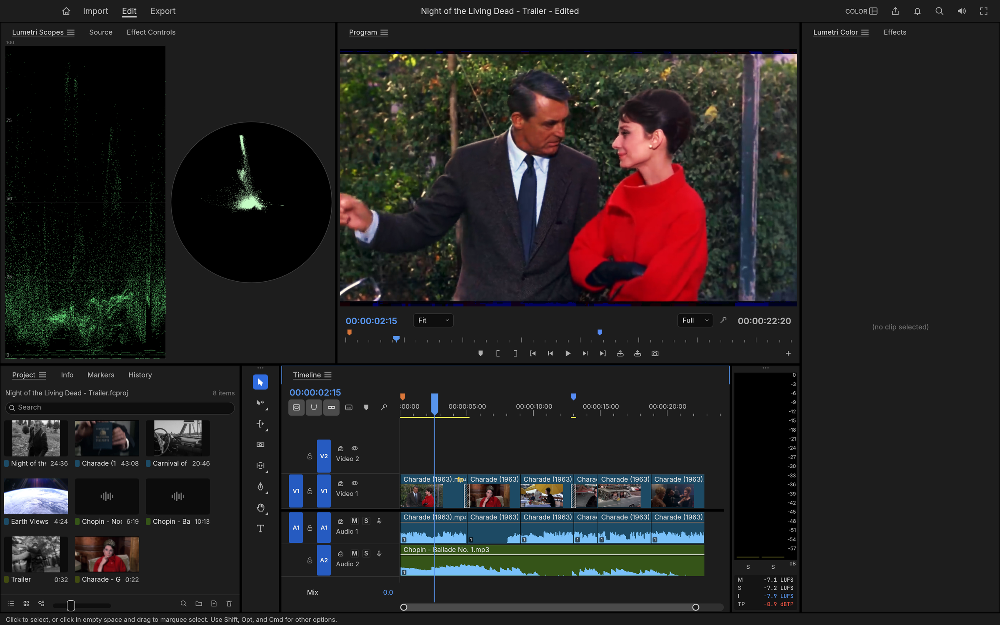
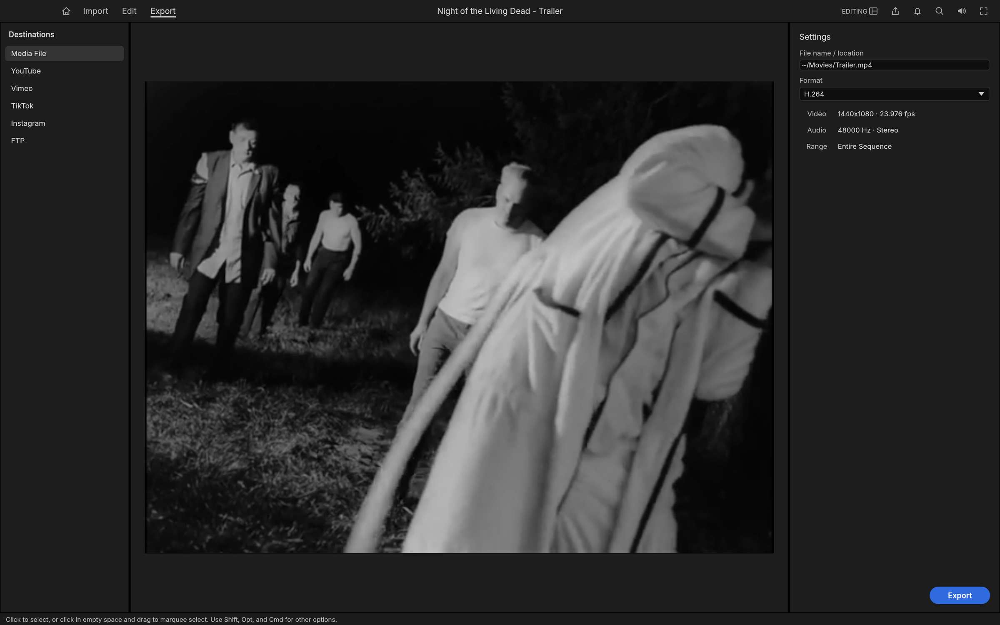

<h1 align="center">Reelwright</h1>

<p align="center">
  <b>A fast, open-source video editor written entirely in Rust.</b><br>
  Multi-track editing and trimming, Lumetri-style color with scopes, keyframed effects, titles and captions,<br>
  mixing with broadcast loudness meters, ProRes / DNxHR / H.264 export, a scriptable command line,<br>
  an MCP server for AI agents, and the very same editor running in your browser.
</p>

<p align="center">
  
  
  
  
</p>

<p align="center">
  <a href="https://www.jonmcgee.online/apps/reelwright/"><b>Try it in your browser</b></a> ·
  <a href="#get-started">Build it</a> ·
  <a href="#whats-new-in-this-fork">What's new</a> ·
  <a href="#status">Status</a> ·
  <a href="#the-family">The family</a> ·
  <a href="#credits-and-license">Credits</a>
</p>

<p align="center">
  
</p>

<p align="center"><sub><i>Apollo 11 - Tranquility</i>: a three-minute documentary edit of NASA's 1969 launch, landing and moonwalk film, with subtitles from the mission transcript. Every frame in these screenshots comes from public-domain footage, decoded, composited and graded by the editor's own code.</sub></p>

Reelwright is a fork of [FilmCraft](https://github.com/storytold/filmcraft), a clean-room, pure-Rust non-linear editor by the ArtCraft Team and contributors. It keeps their engine (exact integer time, one registry of commands that the menus, the command line, a JSON control channel and an MCP server all share, and codecs written from the public specifications) and builds on it, with the original authors credited [below](#credits-and-license). **Try it now: <https://www.jonmcgee.online/apps/reelwright/>**, the real editor compiled to WebAssembly, running entirely in your browser tab. Nothing is uploaded; your footage stays on your machine.

## What's new in this fork

First finished features from the roadmap's gap list, then additions of my own. Everything is a registered command, so it is in the menus, the command search, the control channel, the command line and MCP, and has tests.

| Feature | Where | What it does |
|---|---|---|
| **Edit Statistics** | Sequence › Edit Statistics… · `sequence.editStats` | The rhythm of a cut at a glance: shots, cuts, average and median shot length, cuts per minute, the longest and shortest shot, and a histogram of shot lengths. Overlapping clips that begin together count as one cut, so it describes the pace of the program, not the number of layers. |
| **Export Chapter List** | Markers › Export Chapter List… · `markers.exportChapters` | The sequence's Chapter markers as a ready-to-paste YouTube-style list (`0:00 Intro`) or JSON, with warnings for what a video platform rejects: no chapter at 0:00, fewer than three chapters, chapters shorter than ten seconds. |
| **Check Caption Readability** | Sequence › Captions › Check Readability… · `captions.checkReadability` | Reading speed (characters per second), line length, lines per caption, minimum and maximum on-screen time and the gap to the next caption, for one caption track or all of them. The report lists each problem caption and jumps the playhead to it; `select: true` selects them for fixing. Limits follow common streaming-subtitle guidelines and can all be changed. |
| **Project links** | Help menu · `help.website`, `help.github`, `help.upstream`, `help.reportIssue` | Replace the upstream community links with this project's pages, and credit the upstream project. |
| **Web build tuned for size** | `wasm-release` profile · `cargo xtask web` | The browser build uses a size-optimised profile and `wasm-opt`; the full editor, with the demo project, loads from one static folder. |

<table>
  <tr>
    <td width="50%" valign="top" align="center">
      <br>
      <sub><b>Edit Statistics</b> on the <code>pace-study</code> sample: eleven shots under a second, then three of two to four seconds.</sub>
    </td>
    <td width="50%" valign="top" align="center">
      <br>
      <sub><b>Check Caption Readability</b> on the <code>caption-check</code> sample: every row jumps the playhead to its caption.</sub>
    </td>
  </tr>
</table>

See [`docs/fork-changes.md`](docs/fork-changes.md) for the complete list, including the rebrand.

Both are in the browser build too: open the [live preview](https://www.jonmcgee.online/apps/reelwright/), choose a sample and launch it, then find the command in the Sequence or Markers menu (or the command search).

<p align="center">
  <a href="#edit">Edit</a> ·
  <a href="#color">Color</a> ·
  <a href="#effects-and-motion">Effects</a> ·
  <a href="#audio">Audio</a> ·
  <a href="#titles-and-captions">Titles</a> ·
  <a href="#formats-and-codecs">Formats</a> ·
  <a href="#export">Export</a> ·
  <a href="#interchange">Interchange</a> ·
  <a href="#built-for-agents">Agents</a> ·
  <a href="#get-started">Get started</a> ·
  <a href="#downloads">Downloads</a> ·
  <a href="#documentation">Docs</a> ·
  <a href="#status">Status</a>
</p>

<br>

Reelwright is a non-linear editor for people who know Premiere: the same panels, workspaces, tools and shortcuts, so your hands already know where everything is. Underneath, it is new from the bitstream up. The H.264, HEVC, ProRes and AAC codecs are our own, written in Rust from the public specifications. A GPU compositor works in linear light. Frame math runs on exact integer time, so edits never drift. And every action in the app is a command that an AI agent can drive as precisely as you can.

<br>

## Edit

<p align="center">
  
</p>

<p align="center"><sub>The Assembly workspace, cutting a trailer for <i>Night of the Living Dead</i> (1968) with an insert from <i>Carnival of Souls</i> (1962).</sub></p>

**A timeline you already know.** Source and Program monitors, bins with thumbnails, a multi-track timeline with patch and target buttons, sync locks and linked selection. The Editing, Assembly, Color, Effects and Audio workspaces are all there, and every panel docks wherever you want it.

- **Three-point editing.** Mark In and Out in the Source monitor, then insert (`,`) or overwrite (`.`) onto the patched tracks. Lift (`;`) and extract (`'`) take ranges back out.
- **Every trim.** Ripple, roll, slip, slide, rate stretch and razor tools. Trim mode selects edit points as ripple, roll or trim, nudges them a frame at a time (`⌥←` `⌥→`, ×5 with `⇧`), toggles the trim type with `⌃T` and extends them to the playhead with `E`. `Q` and `W` ripple-trim to the playhead. The **Trim Monitor** shows both sides of the edit, and **dynamic trimming** trims live while it plays: `L` forward, `J` back, `K` to stop and commit as one undo step.
- **Exact time.** Every edit is computed on integer ticks: 254,016,000,000 per second, which divides evenly by every common frame rate and sample rate. 23.976, 29.97 drop-frame and 59.94 are exact, not approximate.
- **The details pros rely on.** Markers with colours, names and durations; add edit (`⌘K`) on one or all tracks; nesting; copy, paste and paste insert; ripple delete and close gap; snapping; unlimited undo with a History panel.
- **Your keys.** A Keyboard Shortcuts editor (`⌥⌘K`) with a drawn keyboard, panel-specific shortcuts, conflict warnings and presets for Reelwright, Premiere Pro, Final Cut Pro and Avid key layouts.
- **Never lose work.** Saves are atomic, auto-save keeps a rolling set of versions, and a crash-recovery journal written about a second after each edit brings back unsaved changes after a crash or power cut.

<p align="center">
  
</p>

<p align="center"><sub>Up close: dissolves, an insert on V2, the score on A2, coloured markers, and the loudness meters on the right.</sub></p>

<br>

## Color

<p align="center">
  
</p>

<p align="center"><sub>The Color workspace on <i>Charade</i> (1963), with live scopes beside the Program monitor.</sub></p>

**A complete Lumetri-style grading panel**, in the order a colourist works:

- **Basic Correction:** temperature and tint, exposure, contrast, highlights, shadows, whites, blacks, saturation.
- **Creative:** eight built-in looks with an intensity control, plus faded film, sharpen and vibrance. The looks are colour transforms written in code, not LUT files.
- **Curves:** an RGB curve editor with monotone-cubic interpolation (no overshoot), and hue vs saturation, hue vs hue, hue vs luma, luma vs saturation and saturation vs saturation.
- **Color Wheels:** shadow, midtone and highlight wheels, each with its own lightness control.
- **HSL Secondary:** key a colour by hue, saturation and luma, view the key as a matte, and correct only what you selected.
- **Vignette:** amount, midpoint, roundness and feather.

<table>
  <tr>
    <td width="34%" valign="top" align="center">
      <br>
      <sub><b>The Lumetri Color panel.</b> Basic Correction, Color Wheels and every other section, each with its own on/off switch.</sub>
    </td>
    <td width="66%" valign="top" align="center">
      <br>
      <sub><b>Scopes that tell the truth.</b> The waveform and vectorscope are computed from the graded frame. All grading happens in linear light, in 32-bit float.</sub>
    </td>
  </tr>
</table>

<br>

## Effects and motion

<p align="center">
  
</p>

<p align="center"><sub>NASA's <i>Earth Views from the ISS</i> with a look applied, and the Effects browser open on the dissolves.</sub></p>

- **Premiere 26's full Video Effects bin (93 effects in 16 folders), the Legacy bin and the obsolete effects old projects use, plus around 30 transitions.** Blurs (Bokeh, Focus, Compound), keys (Ultra Key, Track Matte), distortions (Corner Pin, Turbulent Displace, Warp Stabilizer), Lights & Glows, Immersive Video (VR) effects on equirectangular footage, Posterize Time, Echo and more. Cross dissolve, dip to black or white, film dissolve, wipes, irises, pushes, slides, zooms, page peel, cube spin and more.
- **Motion and opacity on every clip:** position, scale, rotation, anchor point and anti-flicker, plus 26 blend modes.
- **Keyframes like Premiere's:** linear, Bezier, auto and continuous Bezier, hold, ease in and ease out. Effect Controls shows a keyframe lane for every parameter, and each animated parameter opens into **value and velocity graphs** with draggable influence handles.
- **A GPU compositor** built on wgpu (Metal, Vulkan, DirectX 12, WebGPU). It samples YUV straight from the decoder with footprint supersampling and blends in linear light. A CPU path renders the same frames, and the two are tested against each other.

<p align="center">
  
</p>

<p align="center"><sub>An eased push-in on the title card: the value graph, the velocity graph and the Bezier influence handle.</sub></p>

<br>

## Audio

- **Loudness meters to broadcast standards.** Momentary, short-term and integrated loudness and true peak to ITU-R BS.1770 and EBU R128, alongside the peak meters. Our integrated reading matches ffmpeg's `ebur128` filter to the tenth of a LU.
- **Clip effects on our own DSP library:** parametric EQ, high-pass, low-pass and band-pass filters, dynamics, a true-peak limiter, delay, reverb, DeNoise, DeHummer, invert and pitch shift. Parameters can be keyframed. Effects stay continuous across scrubbing, playback and export, with latency compensated.
- **Audio Track Mixer and Audio Clip Mixer:** faders, pan, mute, solo, five insert slots per track (pre- or post-fader), sends, submixes and a Mix track, all sample-accurate and latency-compensated. 24 tracks with three effects each mix about six times faster than real time on one core.
- **Automation like a console:** Read, Latch, Touch and Write modes recorded live from the mixer during playback, shown and edited as track keyframes on the timeline. Plus the Audio Gain dialog (set, adjust, normalize) and constant-power crossfades.
- **Audio-clock playback.** The sound card is the master clock, so picture follows sound and never the other way round.

<br>

## Titles and captions

- **A real text engine:** OpenType shaping with kerning and ligatures, bidirectional text, line breaking, tracking and leading, drawn in linear light and sharp at any scale or rotation.
- **Type, Shape and Pen tools** on the Program monitor: click to type, edit with a caret and selection, drag out rectangles, ellipses and paths. Graphic clips hold text and shape layers with fill, strokes, background and shadow, all keyframable, and edited in the Properties panel.
- **Captions:** caption tracks in Subtitle, CEA-608, CEA-708 and Teletext formats; import and export SRT, WebVTT and SCC with frame-exact timing; edit captions in the Text panel and burn them into exports.
<br>

## Formats and codecs

No FFmpeg inside. The video codecs, AAC, Opus and the containers are our own Rust code, implemented from the public ITU-T, ISO and IETF specifications and tested frame by frame against ffmpeg as an external oracle.

| | Decode | Encode | Notes |
|---|:---:|:---:|---|
| **H.264 / AVC** | ✓ | ✓ | Decoder bit-exact on 37+ streams, 500–600 fps at 1080p. Encoder: High, Main and Baseline profiles, CABAC, B-frames, CRF/CBR/VBR/2-pass |
| **HEVC / H.265** | ✓ | | Main and Main 10, bit-exact on 41 streams (tiles, WPP, PCM, long-term references), about 225 fps at 1080p |
| **Apple ProRes** | ✓ | ✓ | Decodes 422 Proxy to 4444 XQ; export writes 422 HQ |
| **AAC-LC** | ✓ | ✓ | |
| **VP9** | ✓ | | Profiles 0–3, 8/10/12-bit, 4:2:0 to 4:4:4, tiles and superframes; bit-exact on 50+ streams; in WebM/Matroska and MP4 |
| **Opus** | ✓ | | SILK, CELT, hybrid and multistream surround; range-exact on every RFC 8251 conformance vector; in WebM/Matroska and MP4 |
| **AV1** | ✓ | | Main profile, 8/10-bit 4:2:0 and monochrome, every coding tool incl. film grain, superres and spatial layers; bit-exact with libdav1d on the libaom vectors tested; in MP4 and WebM/Matroska |
| **Avid DNxHD / DNxHR** | ✓ | ✓ | All SMPTE ST 2019-1 CIDs (LB to 444, 8/10/12-bit); export writes DNxHR in MOV |
| **MJPEG, PCM** | ✓ | ✓ | |
| **MP3, FLAC, ALAC, Vorbis** | ✓ | | Via the [symphonia](https://github.com/pdeljanov/Symphonia) crate (MPL-2.0) for now, to be replaced by our own |
| **MP4 / MOV** | ✓ | ✓ | Fragmented MP4, edit lists, timecode tracks |
| **Matroska / WebM** | ✓ | | Lacing, Cues, header stripping, HDR colour metadata |
| **Stills** | ✓ | ✓ | Import PNG, JPEG, GIF, WebP, TIFF and BMP; export PNG sequences and animated GIF |

Also imported: MPEG-2 / MPEG-1 video, AC-3, MP2, MXF (OP1a / OP-Atom), MPEG transport and program streams (AVCHD, broadcast, DVD), Ogg and image sequences. Not yet: HEVC and AV1 export, camera RAW, E-AC-3. Hardware decoding works on macOS (VideoToolbox) and Windows (Media Foundation), with Linux to follow; H.264 export can use NVIDIA's encoder on Windows (opt-in) (upstream [#30](https://github.com/storytold/filmcraft/issues/30)).

<br>

## Export

<p align="center">
  
</p>

<p align="center"><sub>Export mode, set to write the trailer as H.264 MP4.</sub></p>

- **H.264 MP4 with AAC, using our own encoders.** A 6-second 960×540 render takes 1.3 seconds and decodes in ffmpeg without a single warning, with strict error detection on.
- **Also:** Apple ProRes 422 HQ and Motion JPEG in QuickTime, MXF OP1a and Avid-style OP-Atom (DNxHR, ProRes or H.264 with PCM and start timecode), PNG sequences, animated GIF and WAV.
- **Background jobs** with progress and cancel, so you keep editing while it renders.
- **Render previews:** the render bar marks segments green, yellow or red; rendered previews are cached by content, so an edit only invalidates what it touches and undo brings the green back.

<br>

## Interchange

Move timelines between Reelwright and every other editor:

- **Final Cut Pro 7 XML (xmeml):** the format Premiere and DaVinci Resolve exchange. It carries nested sequences, transitions, generators, Motion, Opacity, Time Remap and audio levels, with keyframes.
- **FCPXML 1.9–1.11:** the spine, connected clips as lanes, transitions, retiming and compound clips.
- **OpenTimelineIO:** the open interchange format of the film industry, round-tripping every Reelwright detail through `metadata.reelwright`.
- **CMX 3600 EDL:** the oldest format still in use, with drop-frame timecode, dissolves, wipes, speed changes (`M2`) and one EDL per track.
- **AAF (Edit Protocol):** for Avid Media Composer and Pro Tools. Video and audio tracks, dissolves and dips, clip volume with keyframes, markers and source timecode; audio embedded or as separate WAV / AIFF files, trimmed with handles, with clip effects rendered in and broken out to mono, plus an optional video mixdown. Import reads AAF back, extracting embedded audio.
- **OMF 2.0:** the audio-post handoff: the audio tracks with crossfades and gain, sample-accurate, with the audio encapsulated or alongside.

Import merges the document's bins, media and sequences into your project as one undoable step, and links each media file it finds on disk.

<br>

## Built for agents

Every menu item, button, slider and drag in Reelwright is a **command** with an id, typed parameters and an enabled state. There are more than 650 engine commands (`reelwright-cli commands` lists them), with the rest of Premiere's catalogue on the way. The UI, the CLI, a JSON control channel and an **MCP server** all dispatch the same commands, so Claude or any agent can cut, trim, grade, mix and export exactly the way a person does. The UI can also be driven at the level of mouse and keyboard: every widget has an automation id, and agents can click, drag, type and take screenshots.

```jsonc
// over the control channel (JSON lines on TCP) or as MCP tool calls
{"method": "engine.execute", "params": {"command": "timeline.place",
  "params": {"item": 1, "track": "V1", "seconds": 0, "sourceIn": 284298240000000, "duration": 1270080000000}}}
{"method": "engine.execute", "params": {"command": "effects.setParam",
  "params": {"clip": 87, "effect": "lumetri", "param": "curve_luma", "value": [[0,0],[0.25,0.21],[0.75,0.82],[1,1]]}}}
{"method": "ui.screenshot", "params": {"path": "frame.png"}}
```

The trailer and the grades in these screenshots were built exactly this way, by an agent driving the running app.

<br>

## Everywhere

- **Native** on macOS, Windows and Linux, with a native macOS menu bar.
- **The web:** the same engine and UI run in the browser via WebAssembly (`apps/reelwright-web`, see [docs/web.md](docs/web.md)); every release ships it as `reelwright-web-<version>.zip`.
- **Swappable UI.** The interface is one crate (`ui-egui`) over the engine, so a different front end can replace it without touching editing logic.

<br>

## Get started

```sh
cargo run --release -p reelwright                           # the desktop app, with a demo project
cargo run --release -p reelwright -- --control 9876         # plus the JSON-lines control server
cargo run --release -p reelwright-cli -- commands           # list every engine command
cargo run --release -p reelwright-cli -- mcp                # MCP server (headless)
```

Japanese text in the interface and in titles comes from [craft-fonts](https://github.com/storytold/craft-fonts), an optional build input (release builds always include it; without it Reelwright uses its own and the system's fonts):

```sh
git clone https://github.com/storytold/craft-fonts ../craft-fonts
CRAFT_FONTS_DIR="$PWD/../craft-fonts" cargo run --release -p reelwright
```

The control protocol is documented in [docs/control-protocol.md](docs/control-protocol.md). Stuck, or want to show what you made? [Open an issue](https://github.com/game7ballJT/reelwright/issues).

## Documentation

| | |
|---|---|
| [CONTRIBUTING.md](CONTRIBUTING.md) · [docs/contributing.md](docs/contributing.md) | Setup, quality gates, commit conventions, how to add commands, effects, codecs, panels and assets |
| [AGENTS.md](AGENTS.md) | The rules every contributor must follow: assets, clean room, licences |
| [docs/architecture.md](docs/architecture.md) | Layers, data model, time base, command system, render and export pipeline |
| [docs/testing.md](docs/testing.md) | Unit, property and ffmpeg-oracle tests, accuracy criteria, benchmarks |
| [docs/agents.md](docs/agents.md) | Driving Reelwright over MCP and the control channel; how agents develop it |
| [docs/control-protocol.md](docs/control-protocol.md) | Control-channel and MCP reference |
| [docs/project-files.md](docs/project-files.md) | `.fcproj` format, schema migrations, auto-save and crash recovery |
| [docs/graphics.md](docs/graphics.md) · [docs/captions.md](docs/captions.md) | Text engine, graphic clips and tools; caption tracks and formats |
| [ROADMAP.md](ROADMAP.md) | Honest assessment, what's missing, milestones and estimates |

## Status

Reelwright is young and moving fast. Editing, trimming, multicam, colour, keyframes, effects, titles, captions, mixing, codecs and export work today.

We track two numbers ([ROADMAP.md](ROADMAP.md#honest-assessment-2026-10-05)):

- **Feature checklist: ~87%.** Premiere Pro's menu items, effects, transitions, panels and formats that exist in Reelwright.
- **Ready for real work: ~50–60%.** Our honest estimate of how close Reelwright is to replacing Premiere on real projects.

The biggest gaps today:

- **Speed on big footage.** Hardware decoding works on macOS and Windows; Linux has no hardware path yet. Blend modes and the most common effects run on the GPU, but Lumetri, keys and export rendering still run on the CPU; H.264 encoding can use the hardware encoder on macOS and on Windows with an NVIDIA GPU (opt-in, Export ▸ Hardware encoding), and H.265 export is hardware-only there (upstream [#30](https://github.com/storytold/filmcraft/issues/30)).
- **No plugins.** No VST3 / Audio Units or OpenFX hosting.
- **Delivery codecs.** H.264 is our only delivery-codec export; no HEVC or AV1 export yet.
- **Real-world media and platforms.** Our decoders are bit-exact on conformance streams, but camera and phone files in the wild are less tested. Windows and Linux get far less testing than macOS.
- **AI features.** Few so far; speech to text is optional and off by default.

Bug reports with real footage are the most useful thing you can send us: [open an issue](https://github.com/game7ballJT/reelwright/issues).

## Architecture

A layered Cargo workspace:

| Layer | Crates |
|---|---|
| Codecs and containers | `h264`, `h264enc`, `hevc`, `vp9`, `prores`, `aac`, `opus`, `isobmff`, `matroska`, `bitstream` |
| Foundations | `time`, `geom`, `color`, `frame`, `media`, `text`, `project`, `audio-dsp` |
| Editing and interchange | `edit`, `codecs`, `captions`, `format` (project files), `interchange` |
| Rendering and output | `render`, `gpu`, `export` |
| Engine | `engine`: command registry, session, undo, jobs |
| Front ends | `ui-egui`, `automation` (MCP), `apps/reelwright`, `apps/reelwright-cli` |
| Test support | `testkit` (ffmpeg oracles, fixtures), `golden` (golden-image tests) |

Nothing below the front ends depends on a UI toolkit or OS API. `cargo xtask ci` checks formatting, lints, tests, the layering rules, asset attribution and the wasm build.

## Downloads

No release has been published yet. Until the first one, build from source (see [Get started](#get-started)) or use the browser build at <https://www.jonmcgee.online/apps/reelwright/>.

Release builds are made by [`.github/workflows/release.yml`](.github/workflows/release.yml) when the `release` branch is pushed (or the workflow is run by hand): Windows (x64, arm64, x86) MSI installers and portable zips, a universal macOS DMG, Linux AppImage, Flatpak, `.deb`, `.rpm` and tarballs, FreeBSD tarballs and the web build, each with a `SHA256SUMS.txt`. This fork has no signing certificates, so those builds are **unsigned**: Windows SmartScreen and macOS Gatekeeper will warn before the first run.

## The family

Reelwright is one of a growing family of forks of the ArtCraft Team's creative apps. Each has its own repository and a live preview in the browser:

| | App | What it is for | Forked from | Code | Live preview |
|:-:|---|---|---|---|---|
|  | **Pixelwright** | Image editing: layers, masks, type and real PSD files | [PhotoCraft](https://github.com/storytold/photocraft) | [GitHub](https://github.com/game7ballJT/pixelwright) | [Try it](https://www.jonmcgee.online/apps/pixelwright/) |
|  | **Splinewright** | Vector illustration: paths, Pathfinder, live effects, SVG and PDF | [VectorCraft](https://github.com/storytold/vectorcraft) | [GitHub](https://github.com/game7ballJT/splinewright) | [Try it](https://www.jonmcgee.online/apps/splinewright/) |

## Credits and license

Reelwright is a modified fork of **[FilmCraft](https://github.com/storytold/filmcraft)**, copyright (c) 2026 the ArtCraft Team and the FilmCraft contributors, whose work this repository builds on and whose history it preserves. All of it, and the changes made here, are available under the same terms: [MIT](LICENSE-MIT) or [Apache-2.0](LICENSE-APACHE), at your option. This fork is independent and is not affiliated with or endorsed by the upstream authors; it carries none of their branding, as their brand license requires of forks. Required notices are in [NOTICE](NOTICE).

Bundled fonts, icons, images and other assets keep their own open licenses; each one is listed with its author, source and license in [ATTRIBUTION.md](ATTRIBUTION.md). The app icon is original work made for this project. Builds made with [craft-fonts](https://github.com/storytold/craft-fonts) also embed its fonts (OFL-1.1), listed in its [ATTRIBUTION.md](https://github.com/storytold/craft-fonts/blob/main/ATTRIBUTION.md).

**Footage and music in the screenshots:** NASA's Apollo 11 film and television footage from [images.nasa.gov](https://images.nasa.gov) (launch, Launch Control Center, lunar surface and recovery) and the Apollo 11 air-to-ground voice transcript, all US Government works in the public domain (NASA does not endorse this project); *Night of the Living Dead* (1968), *Carnival of Souls* (1962) and *Charade* (1963), all in the US public domain; *Earth Views from the ISS* by NASA; Chopin's Nocturne Op. 48 No. 1 and Ballade No. 1, performed for Musopen and released under CC0. The media itself is not in this repository. Sources and details for every asset are in [ATTRIBUTION.md](ATTRIBUTION.md).

Reelwright is an independent implementation. It contains no Adobe code, icons, images, presets or LUTs, and no GPL or LGPL code; ffmpeg is used only as an external test oracle.

<sub>Adobe, Premiere Pro and other product names are trademarks or registered trademarks of Adobe Inc. in the United States and/or other countries. Reelwright is an independent open-source project, is not affiliated with, sponsored by or endorsed by Adobe Inc., and uses these names only to describe the file formats and workflows it is compatible with.</sub>
